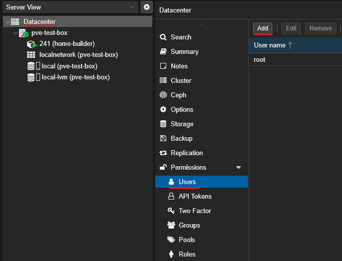
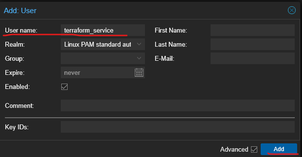
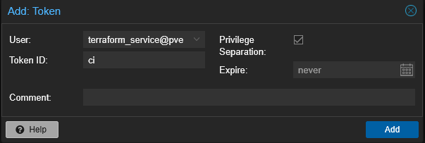
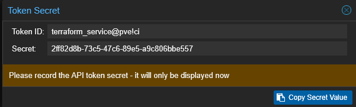

- [Getting started](#getting-started)
  - [Install Proxmox VE (PVE)](#install-proxmox-ve-pve)
  - [Build server](#build-server)
    - [Install with script](#install-with-script)
    - [Install manually](#install-manually)
      - [Setup storage and resource pool](#setup-storage-and-resource-pool)
      - [Add user and setup permissions](#add-user-and-setup-permissions)
      - [Create build server container](#create-build-server-container)
      - [Install Terraform](#install-terraform)

# Getting started
## Install Proxmox VE (PVE)
See https://proxmox.com/en/products/proxmox-virtual-environment/get-started
The sample configuration names the PVE host `pve-test-box` running at `192.168.50.250:8006`.

SSH into the freshly installed PVE host as root.

To run the build server setup script, we need to install jq (for json parsing).
```bash
apt update && apt install --yes jq
```

## Build server
### Install with script
Still on the PVE host; create a separate working folder.
```bash
mkdir home-stack && cd home-stack
```

Download the config file(s) and rename them, removing the 'sample.' prefix.
```bash
curl -O "https://raw.githubusercontent.com/dotnick-pebbles/home-stack/refs/heads/main/vars/sample.common.config.json" && \
mv sample.common.config.json common.config.json
```

Make sure to update any variables to suit your needs, for example host network and PVE settings.

Run the setup script.
```bash
curl -sSL https://raw.githubusercontent.com/dotnick-pebbles/home-stack/refs/heads/main/bootstrap/setup_build_server.sh | bash
```
Note that, among other things, a Proxmox VE API token is created. The secret value is recorded a secret file in the working directory the script is executed from. The name is decrived from the 'host_settings.token_id' value in the config file (default name will be `.home-stack-ci_secret`).

### Install manually
This section will go through the manual steps needed to configure the PVE host as well as setup the build server.

#### Setup storage and resource pool
#### Add user and setup permissions
#### Create build server container
#### Install Terraform
Terraform needs a way to communicate with the Proxmox VE server. For that, create a dedicated user and API token.

1. Go to Datacenter > Permissions > Users > Add

1. Give it a user name and click add. I will be using `terraform_service`.

1. Go to Datacenter > Permissions > Users > API Tokens
1. Select the user created in the previous step and give the token an id.

1. Click 'Add' and copy the secret value. We will need this later.


Copy the sample .secrets.env.
```bash
cp ~/git/home-stack/vars/sample.secrets.env ~/git/home-stack/vars/secrets.env
```
Update the value of `proxmox_ve_api_token`. Replace 'token_id' and 'token_secret' with the values from the popup. Otherwise the format is `user_name@realm!token_id=token_secret_value` In this example the value would be 'terraform_service@pve!ci=2ff82d8b-73c5-47c6-89e5-a9c806bbe557'. Also update `proxmox_ve_ssh_password` and `proxmox_ve_ssh_password`.
